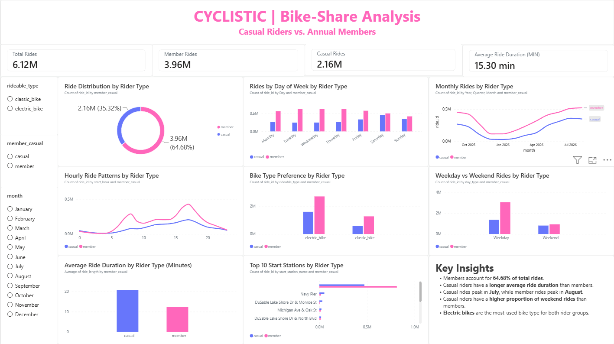

# Cyclistic Bike-Share Analysis

### A Data Analytics Case Study | Google Data Analytics Certificate

## 1. Project Overview

This project analyses bike-share usage data from Cyclistic, a fictional bike-share company based in Chicago.

The main objective is to understand how annual members and casual riders use Cyclistic bikes differently and identify opportunities to encourage casual riders to purchase annual memberships.

The analysis covers **1 September 2025 to 31 August 2026**, using 6,115,650 ride records.

## 2. Business Task

The marketing team wants to understand the differences between casual riders and annual members.

The analysis focuses on:

- How ride usage differs between casual riders and annual members.
- Differences in average ride duration.
- Daily, monthly and hourly ride patterns.
- Bike-type preferences.
- Popular starting stations.
- Opportunities to encourage casual riders to become annual members.

## 3. Tools and Technologies

| Tool | Purpose |
|---|---|
| Microsoft Excel | Data inspection and preparation |
| Python (Pandas) | Data cleaning and preparation |
| MySQL | Data storage and SQL analysis |
| Power BI | Interactive dashboard and visualization |

## 4. Project Workflow

1. **Ask:** Define the business problem and analysis questions.
2. **Prepare:** Collect and inspect the monthly Cyclistic trip-data files.
3. **Process:** Clean duplicate records, calculate ride duration and prepare analysis columns using Python and Excel.
4. **Analyze:** Use MySQL queries to compare rider behaviour and identify patterns.
5. **Share:** Present findings through an interactive Power BI dashboard and final report.
6. **Act:** Suggest marketing strategies based on the analysis.

## 5. Key Findings

### 5.1 Rides by Rider Type

| Rider Type | Total Rides | Percentage |
|---|---:|---:|
| Annual Members | 3,955,534 | 64.68% |
| Casual Riders | 2,160,116 | 35.32% |
| **Total** | **6,115,650** | **100%** |

### 5.2 Average Ride Duration

| Rider Type | Average Duration |
|---|---:|
| Casual Riders | 20.66 minutes |
| Annual Members | 12.37 minutes |

Casual riders take longer rides on average than annual members.

### 5.3 Weekday and Weekend Usage

- Casual riders have a higher weekend ride share of 37.26%.
- Annual members have a weekend ride share of 23.34%.
- Casual riders record their highest ride volume on Saturday.
- Annual members record their highest ride volume on Wednesday.

### 5.4 Monthly Trends

- Casual rider activity peaks in July.
- Annual member activity peaks in August.
- December records the lowest ride volume for both groups.

### 5.5 Bike-Type Preference

Electric bikes are the most-used bike type for both rider groups.

- Casual riders: 73.60% electric-bike share.
- Annual members: 68.06% electric-bike share.

### 5.6 Popular Starting Stations

- Most popular casual starting station: Navy Pier (51,740 rides).
- Most popular member starting station: Canal St & Madison St (23,179 rides).

## 6. Power BI Dashboard

The interactive dashboard presents:

- Total rides and key performance indicators.
- Rider-type distribution.
- Monthly ride trends.
- Weekday and weekend comparisons.
- Hourly ride patterns.
- Average ride duration.
- Bike-type preferences.
- Popular starting stations.

The dashboard includes slicers to explore the data by rider type, month and bike type.



## 7. Business Recommendations

1. **Weekend Membership Campaigns:** Test membership promotions targeting casual riders during weekends.
2. **Seasonal Campaigns:** Run membership campaigns during higher-activity months, especially spring and summer.
3. **Station-Based Marketing:** Explore opportunities at stations with high casual rider activity, such as Navy Pier.
4. **Repeat Usage Analysis:** Study repeat casual usage if suitable privacy-safe data becomes available.
5. **Measure Campaign Results:** Compare actual membership conversions before deciding which strategies are effective.

## 8. Repository Structure

```text
Cyclistic-Bike-Share-Analysis/
│
├── Python/
│   └── prepare_data.py
│
├── REPORT/
│   └── CYCLISTIC.docx
│
├── Cyclistic_Dashboard.png
├── Cyclistic_SQL_Analysis.sql
├── cyclistic_cleaned_sample.csv
└── README.md
```

## 9. Data Source and Reproducibility

The original Cyclistic trip data is available from the [Divvy System Data website](https://divvybikes.com/system-data).

The complete raw and cleaned datasets are not included in this repository because of their large file sizes. A 10,000-row cleaned sample is provided for preview.

**To reproduce the data preparation:**

1. Download the required monthly trip-data CSV files from the official source.
2. Create a folder named `01_Raw_Data` in your local project folder.
3. Place the downloaded monthly CSV files inside `01_Raw_Data`.
4. Keep `prepare_data.py` inside the `Python` folder.
5. Install the required Python library:

   ```bash
   pip install pandas
   ```

6. Run the script from the main project folder:

   ```bash
   python Python/prepare_data.py
   ```

The script automatically creates the `02_Cleaned_Data` folder and saves the prepared dataset as `cyclistic_cleaned.csv`.

The SQL analysis, dashboard preview, cleaned-data sample, and final report are included in this repository to document the analysis and findings.

## 10. Limitations

- Ride records do not represent unique customers.
- The dataset does not explain why riders choose casual rides or annual memberships.
- Missing station information can affect station-level comparisons.
- Long rides can influence average ride-duration calculations.
- Marketing recommendations require further testing to measure actual membership conversions.

## 11. Conclusion

This project helped me apply the complete data analytics workflow using Excel, Python, MySQL and Power BI.

The analysis identified differences in riding patterns between casual riders and annual members. These findings provide opportunities for Cyclistic to test weekend, seasonal and station-based membership campaigns.

The effectiveness of these recommendations should be measured through further analysis and marketing experiments.

---

**Project Type:** Data Analytics Case Study

**Tools:** Excel | Python | MySQL | Power BI

**Reporting Period:** September 2025 – August 2026
